# 3D-Art
A Collection of my 3D modelling projects or art fragments which were made using blender.

## My 3D Projects

### Bedroom Scene

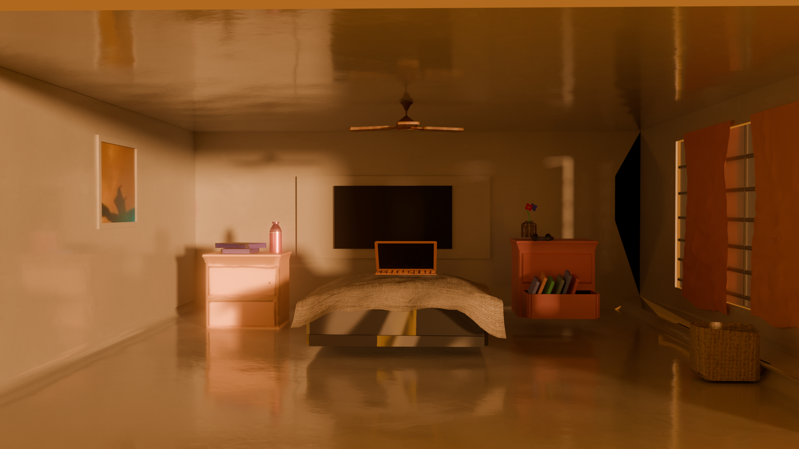

## Luke Skywalker's Lightsaber

A 3D recreation of Luke Skywalker's lightsaber.

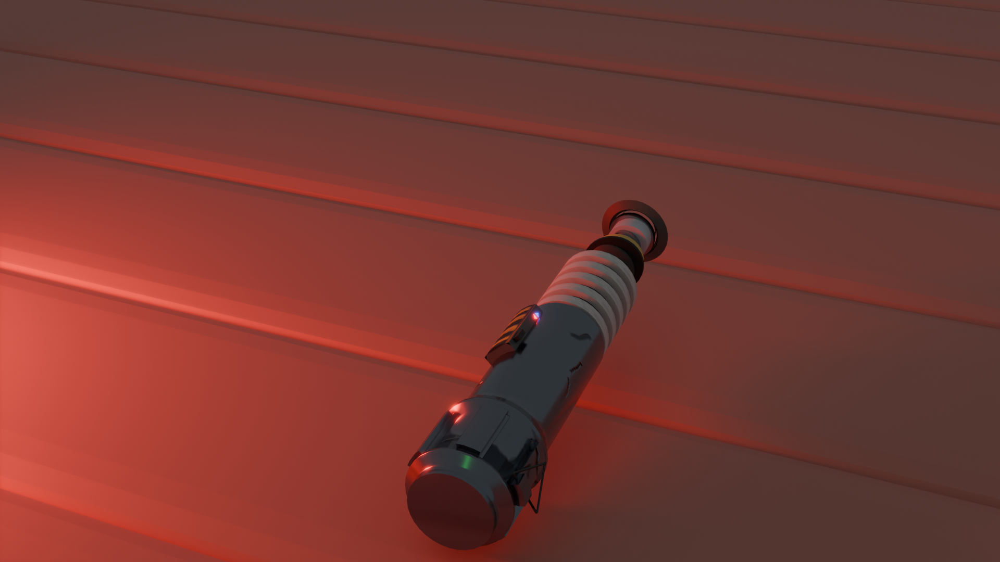
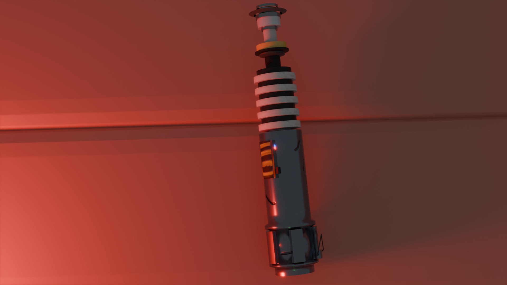
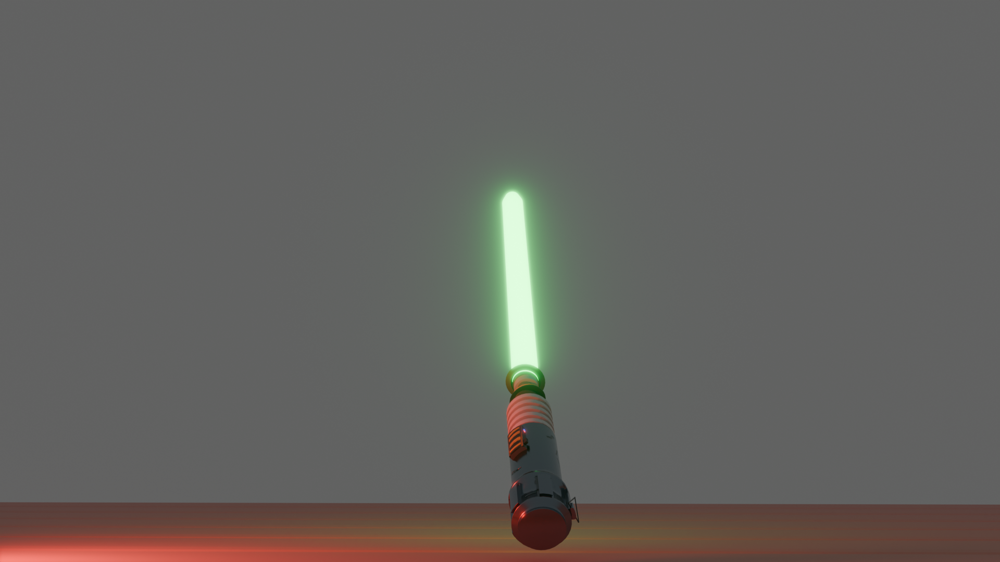
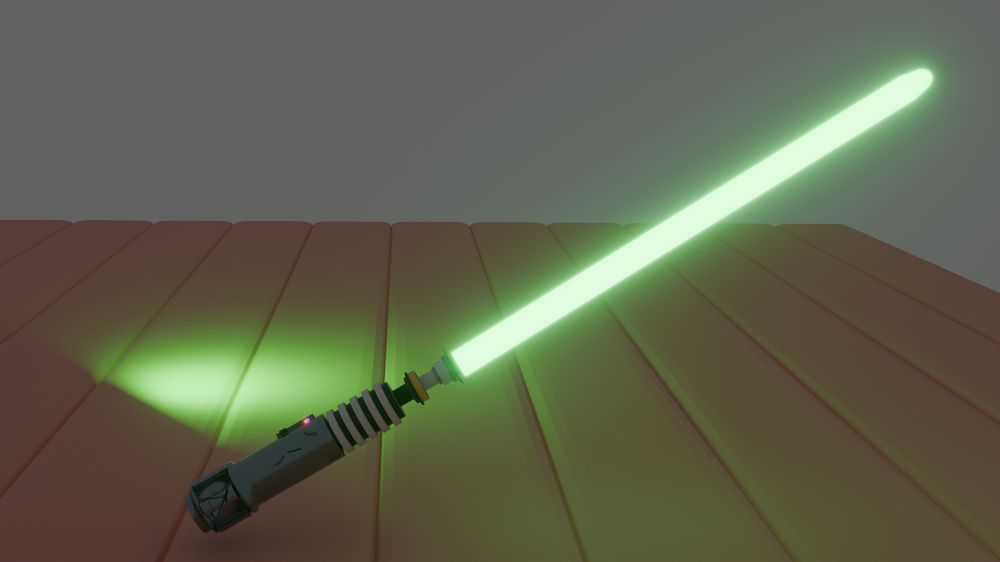
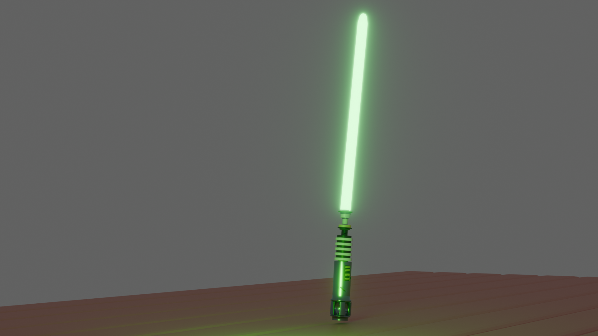
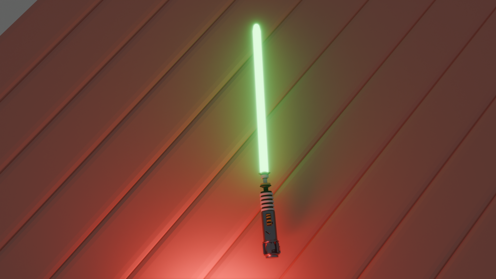

## Bowl of Apples

A 3D bowl filled with apples.

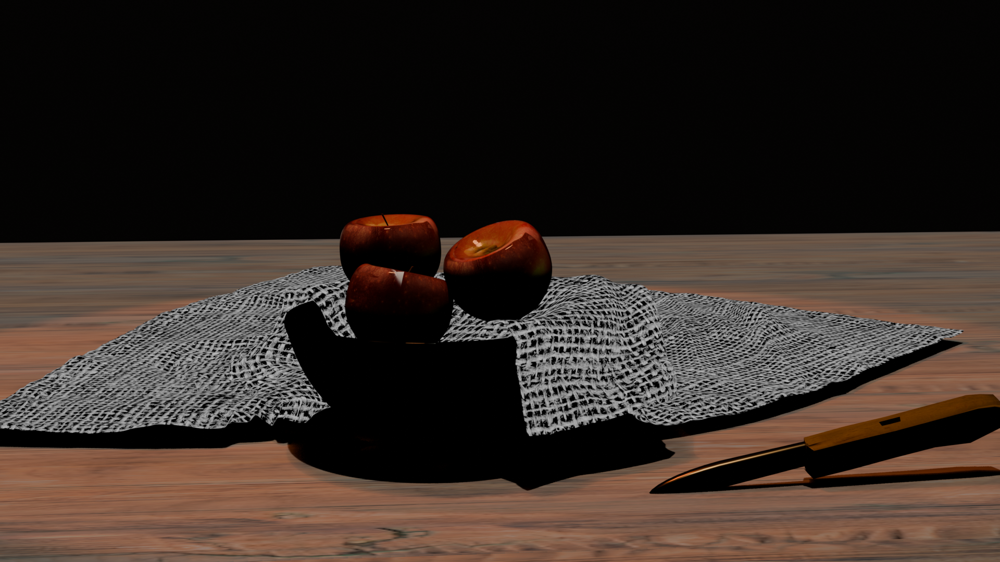

## Arduino

A 3D model of an Arduino board.

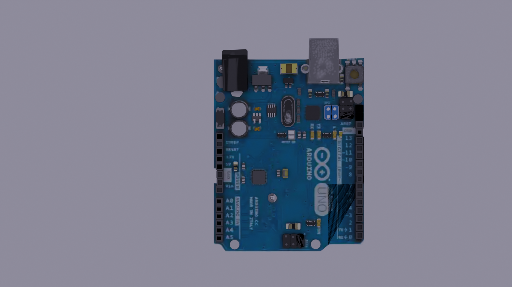
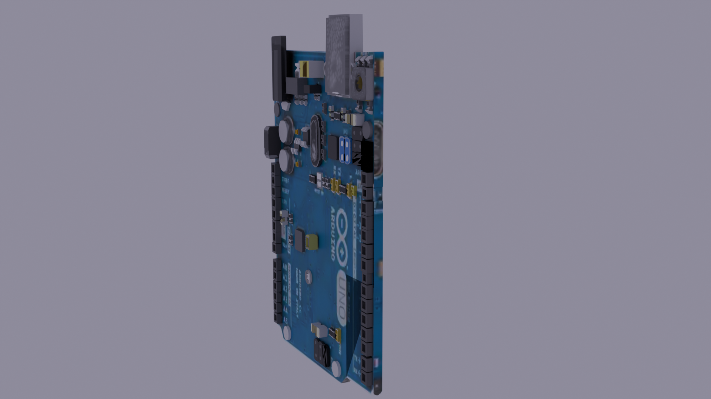
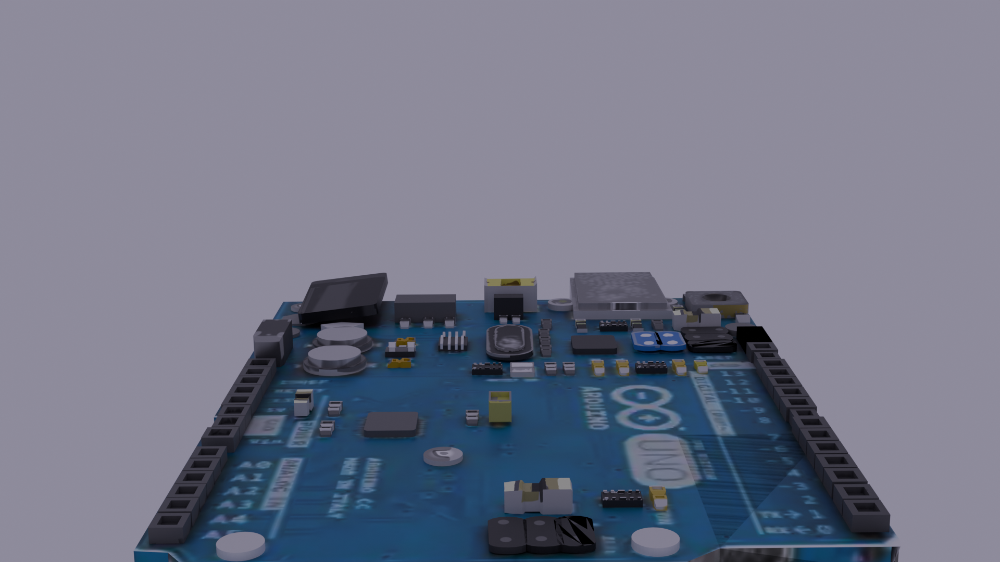
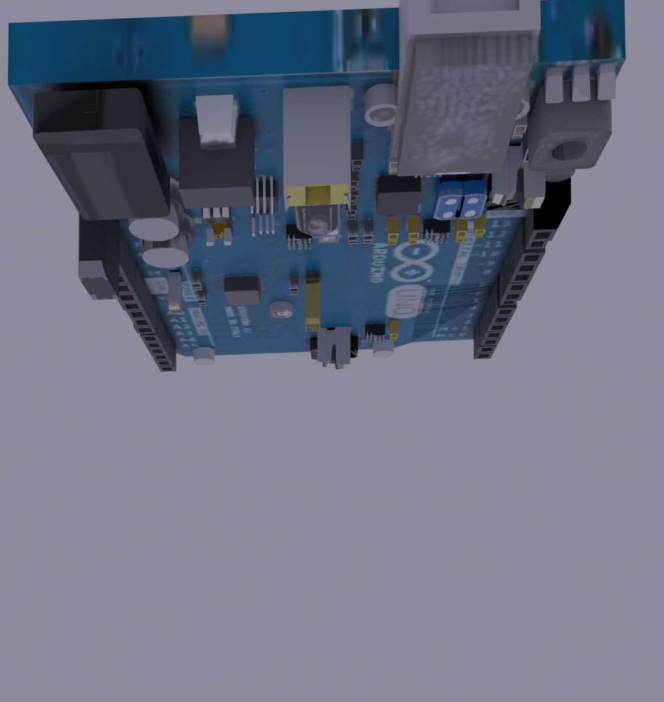

## Donut and Drink

A 3D donut scene with a drink.

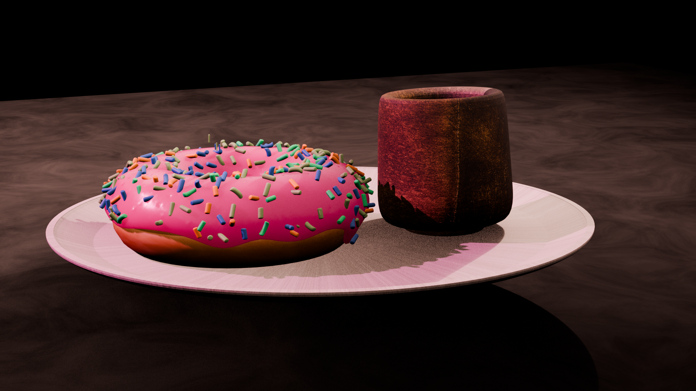

## TIE Fighter Attack Scene

A TIE Fighter attacking a base.

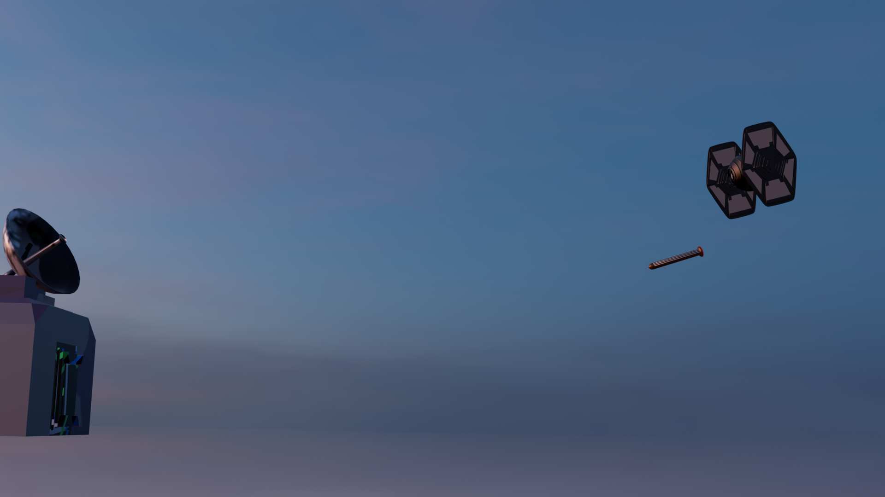

## TIE Fighter

The same TIE Fighter model showcased from different angles.

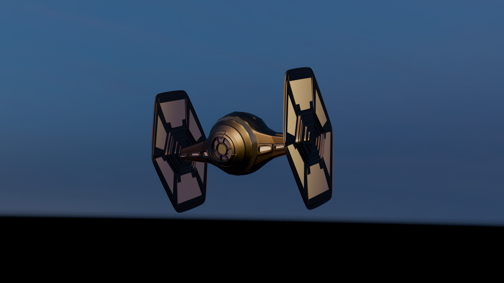
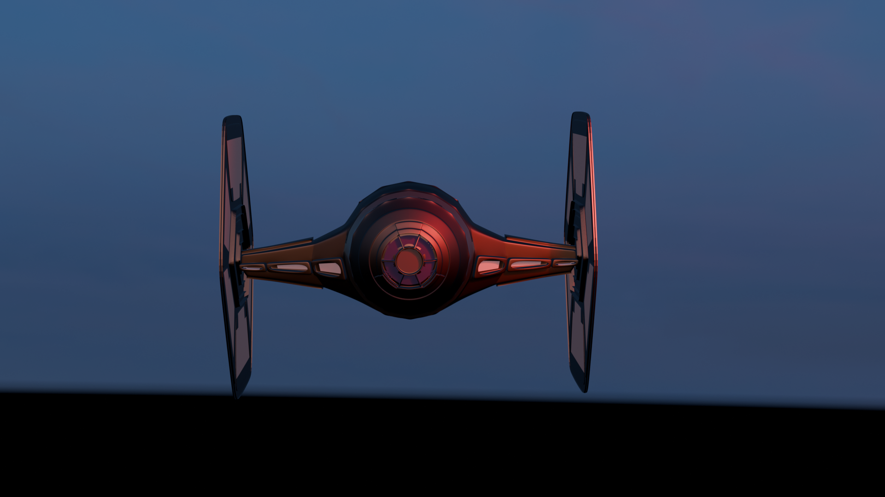
